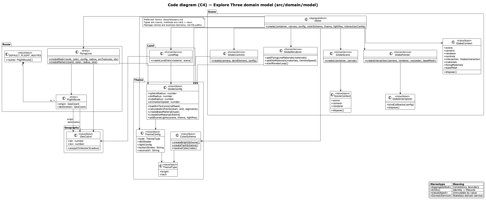

# C4 模型文档

使用 PlantUML 绘制的 C4 架构模型，描述 Explore Three（交互式 Three.js 地球仪）。

Source of truth: `.puml`。官方 C4: [c4model.com](https://c4model.com/)。库: [C4-PlantUML](https://github.com/plantuml-stdlib/C4-PlantUML)。

## Visual tracks (do not mix)

| Track | Files | Style |
| ----- | ----- | ----- |
| **Structural C4** | C1–C3, Deployment | [`style.puml`](style.puml) tokens **inlined** after C4 include (white / black) |
| **Domain model** | `C4-Code-Domain-Model.puml` | `!theme plain` + white/black class skinparam |
| **Dynamics** | `C4-Dynamic-*` | `!theme plain` sequence (no zinc palette) |

## 文件

| 文件 | 层级 | 说明 |
| --- | --- | --- |
| `style.puml` | Shared | Structural white/black tokens（结构图内联，勿 `!include`） |
| `C4-Code-Domain-Model.puml` | Code | 领域模型（`src/domain/model/`；Glossary Preferred Term） |
| `C1-Context.puml` | C1 | 系统上下文（后续层补充） |
| `C2-Container.puml` | C2 | 容器图（后续层补充） |
| `C3-Component.puml` | C3 | 组件图（后续层补充） |
| `C4-Deployment.puml` | Deployment | 部署图（后续层补充） |
| `C4-Dynamic-Globe-Bootstrap.puml` | Dynamic | 地球仪引导序列（后续层补充） |

## Code - 领域模型



按业务域分包（Geography / Route / Theme / Land / Scene）。术语见 [Glossary](../../Glossary.md)。

## Render

```bash
cd docs/developer/c4-model && mkdir -p png && plantuml -tpng -o png *.puml
```

## 相关

- [Glossary](../../Glossary.md)
- [User Story Map](../../product-owner/User-Story-Map.md)
